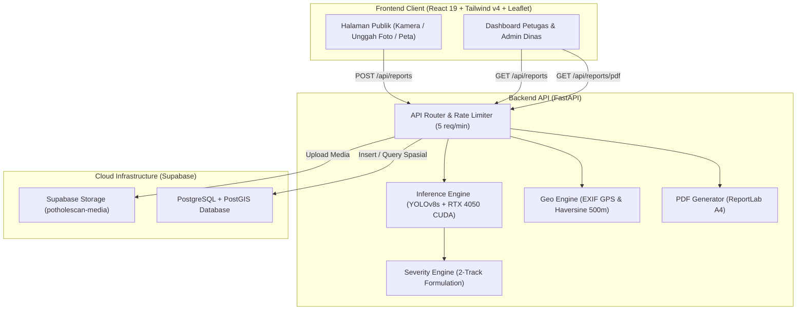

# PotholeScan: Platform Deteksi & Tata Kelola Kerusakan Jalan Berbasis AI

[](https://fastapi.tiangolo.com)
[](https://github.com/ultralytics/ultralytics)
[](https://pytorch.org)
[](https://supabase.com)
[](https://react.dev)
[](https://tailwindcss.com)

**PotholeScan** adalah sistem cerdas *end-to-end* untuk deteksi otomatis, penentuan tingkat keparahan (*severity*), dan tata kelola penanganan kerusakan jalan (lubang dan retakan) berbasis kecerdasan buatan (*Deep Learning* YOLOv8s) dan sistem informasi geografis PostGIS.

Dibangun dengan arsitektur modern yang memisahkan pelaporan warga (*Public Crowdsourcing*) dan manajemen operasional dinas (*Staff & Admin Dashboard*), terintegrasi langsung dengan ekspor dokumen rekapitulasi resmi Dinas PUPR.

---

## 📌 Fitur Utama

1. **Deteksi Kerusakan Jalan Berbasis AI (YOLOv8s):**
   - Deteksi real-time objek *pothole* (lubang) dan *crack* (retakan jalan).
   - Inferensi ultra-cepat (~16 ms per citra) memanfaatkan akselerasi GPU NVIDIA CUDA.
2. **Formulasi Keparahan 2-Jalur Terkalibrasi (*Calibrated Severity Grading*):**
   - Jalur Area ($R_{\text{area}} = \frac{\text{Area BBox}}{\text{Area Citra}}$) untuk lubang (*pothole*).
   - Jalur Rentang ($R_{\text{span}} = \max(w, h)$) untuk retakan (*crack* memanjang).
   - Klasifikasi otomatis: **RINGAN**, **SEDANG**, dan **BERAT** dengan mitigasi *worst-case escalation*.
3. **Penyelesaian Lokasi Cerdas (*Location Resolution*):**
   - Ekstraksi koordinat otomatis dari EXIF metadata kamera smartphone pelapor.
   - Fallback otomatis ke *browser geolocation* (HTML5 Geolocation API) dan *manual coordinate entry*.
4. **Analisis Geospasial Spasial PostGIS:**
   - Kueri radius 500 meter untuk menghitung akumulasi kerusakan aktif di sekitar titik laporan.
   - Deteksi dan pencegahan duplikasi laporan warga pada segmen jalan yang sama.
5. **Dashboard Operasional & Tata Kelola Dinas:**
   - Manajemen status penanganan: `BARU` $\rightarrow$ `DIVERIFIKASI` $\rightarrow$ `DALAM_PENANGANAN` $\rightarrow$ `SELESAI`.
   - Filter spasial, visualisasi sebaran peta Leaflet dengan radius pulse, dan audit trail (*status history*).
6. **Ekspor Dokumen PDF Rekapitulasi Resmi Dinas PUPR:**
   - Pembuatan laporan rekapitulasi resmi format A4 instan menggunakan ReportLab dengan kop dinas resmi, tabel kronologi, dan ringkasan kerusakan.

---

## 📊 Benchmark & Evaluasi Model AI

Model YOLOv8s dilatih menggunakan dataset 1.330 citra jalan (split 70% Train, 20% Val, 10% Test) dengan akselerasi lokal GPU NVIDIA GeForce RTX 4050:

| Metrik Evaluasi | Target Standar SRS | Hasil Capaian Model | Status |
| :--- | :---: | :---: | :---: |
| **mAP@0.5** | $\ge 70.0\%$ | **86.9%** | **Lolos (Unggul)** |
| **Recall (Sensitivitas)** | $\ge 75.0\%$ | **78.2%** | **Lolos** |
| **Precision** | - | **85.2%** | **Optimal** |
| **Latensi Inferensi** | $\le 1000\text{ ms}$ | **16.01 ms** / citra | **Super Cepat** |

> Seluruh kurva evaluasi (*Confusion Matrix, Precision-Recall Curve, F1-Confidence Curve*) terdokumentasi di folder [`docs/training_metrics/`](docs/training_metrics/).

---

## 🏗️ Arsitektur Sistem



---

## 📂 Struktur Direktori Proyek

```text
potholescan/
├── .gitignore                   # Konfigurasi pengamanan repository Git
├── README.md                    # Dokumentasi utama proyek
├── package.json                 # Konfigurasi dependensi frontend
├── vite.config.ts               # Konfigurasi Vite & proxy API
├── index.html                   # Shell HTML aplikasi
├── src/                         # Source code antarmuka pengguna (Frontend)
│   ├── api.ts                   # Klien HTTP Axios/Fetch ke backend
│   ├── App.tsx                  # Controller navigasi utama
│   ├── main.tsx                 # Entrypoint React 19
│   └── components/
│       ├── Public.tsx           # Antarmuka pelaporan warga
│       ├── Staff.tsx            # Dashboard tindak lanjut petugas dinas
│       ├── Admin.tsx            # Dashboard analitik & tata kelola administrator
│       ├── MapView.tsx          # Peta spasial interaktif OpenStreetMap / Leaflet
│       ├── Login.tsx            # Autentikasi petugas dinas
│       ├── Camera.tsx           # Penangkapan citra langsung dari kamera
│       └── shared.tsx           # Modal ekspor PDF dinas & komponen bersama
├── backend/                     # Source code backend & engine AI (Python 3.12)
│   ├── app/
│   │   ├── api/                 # Endpoint REST (auth, reports, nearby, pdf, settings)
│   │   ├── core/                # Konfigurasi environment, JWT, & rate limiting
│   │   ├── models/              # Skema data Pydantic v2
│   │   ├── services/            # Engine inferensi YOLOv8, PostGIS, & PDF
│   │   └── main.py              # Entrypoint server FastAPI
│   ├── weights/
│   │   └── best.pt              # Bobot model AI terbaik hasil pelatihan lokal
│   ├── scripts/
│   │   ├── train_local.py       # Skrip pelatihan lokal YOLOv8s dengan CUDA
│   │   ├── evaluate_model.py    # Skrip evaluasi performa model mAP
│   │   └── setup_database.sql   # Skrip DDL PostGIS & tabel Supabase
│   ├── tests/                   # 14 unit test otomatis (Pytest)
│   ├── requirements.txt         # Daftar pustaka Python backend
│   └── README.md                # Panduan teknis khusus backend
└── docs/                        # Dokumentasi terpusat
    ├── specifications/          # PRD, SRS, HDD, TECH_STACK, METODOLOGI
    └── training_metrics/        # Bukti visual evaluasi metrik AI
```

---

## 🚀 Panduan Memulai Cepat (*Quick Start*)

### 1. Prasyarat Sistem
- **Node.js** v20+ & **npm** v10+
- **Python** 3.12+
- *(Opsional namun direkomendasikan)*: GPU NVIDIA dengan CUDA 12.x untuk akselerasi inferensi AI.

---

### 2. Menjalankan Backend API

1. Masuk ke direktori `backend`:
   ```bash
   cd backend
   ```
2. Buat dan aktifkan *Virtual Environment*:
   ```bash
   python -m venv .venv
   # Windows PowerShell:
   .\.venv\Scripts\Activate.ps1
   # Linux/macOS:
   source .venv/bin/activate
   ```
3. Pasang seluruh dependensi:
   ```bash
   pip install -r requirements.txt
   # Untuk GPU CUDA (NVIDIA):
   pip install torch torchvision --index-url https://download.pytorch.org/whl/cu124
   ```
4. Buat file `.env` di dalam folder `backend/`:
   ```env
   SUPABASE_URL=https://ID_PROYEK_ANDA.supabase.co
   SUPABASE_SERVICE_ROLE_KEY=kunci_service_role_supabase_anda
   SUPABASE_STORAGE_BUCKET=potholescan-media
   JWT_SECRET_KEY=rahasia-keamanan-potholescan-2026
   ```
5. Jalankan backend server:
   ```bash
   uvicorn app.main:app --host 127.0.0.1 --port 8000 --reload
   ```
   - Server berjalan di: `http://127.0.0.1:8000`
   - Dokumentasi Swagger UI: `http://127.0.0.1:8000/docs`

---

### 3. Menjalankan Frontend

Buka terminal baru di direktori root proyek:
```bash
npm install
npm run dev
```
Aplikasi frontend akan aktif di: **`http://localhost:5173`** *(otomatis terhubung melalui reverse proxy `/api` ke backend port 8000)*.

---

## 🔑 Akun Uji Coba Default (*Demo Credentials*)

| Peran | Username | Password | Hak Akses |
| :--- | :--- | :--- | :--- |
| **Administrator** | `admin` | `admin123` | Akses penuh, manajemen laporan, rekapitulasi, & ekspor PDF |
| **Petugas Lapangan** | `petugas01` | `petugas123` | Verifikasi teknis & pembaruan status penanganan jalan |

---

## 📄 Lisensi
Proyek ini dikembangkan di bawah lisensi MIT. Silakan gunakan dan kembangkan untuk kepentingan publik dan infrastruktur tata kelola jalan yang lebih baik.
