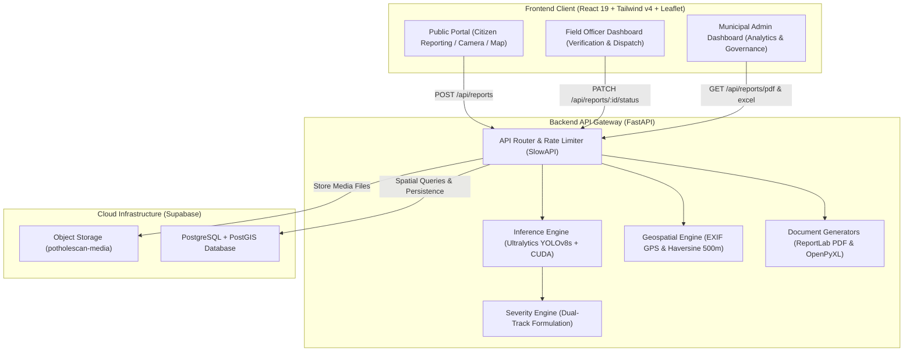

# PotholeScan: AI-Powered Road Distress Detection & Municipal Infrastructure Management Platform

[](https://fastapi.tiangolo.com)
[](https://github.com/ultralytics/ultralytics)
[](https://pytorch.org)
[](https://supabase.com)
[](https://react.dev)
[](https://tailwindcss.com)
[](https://www.typescriptlang.org)
[](LICENSE)

**PotholeScan** is an end-to-end intelligent road infrastructure management and damage detection system. Powered by **YOLOv8s deep learning** and **Supabase PostGIS geospatial analytics**, PotholeScan automates road distress identification (potholes and cracks), performs calibrated severity grading, and streamlines municipal road maintenance workflows from citizen crowdsourcing to official public works dispatch.

Built with a modular modern architecture, it seamlessly connects citizen reporting with municipal field operations, featuring real-time spatial mapping, verification audit trails, and automated generation of official A4 inspection reports and Excel audit summaries.

---

## 📑 Table of Contents
- [Key Features](#-key-features)
- [AI Model Benchmarks & Metrics](#-ai-model-benchmarks--metrics)
- [System Architecture](#️-system-architecture)
- [Repository Structure](#-repository-structure)
- [Tech Stack](#-tech-stack)
- [Quick Start Guide](#-quick-start-guide)
  - [Prerequisites](#1-prerequisites)
  - [Backend Setup](#2-backend-api-setup)
  - [Database Configuration](#3-database-configuration-supabase-postgis)
  - [Frontend Setup](#4-frontend-setup)
- [Automated Testing](#-automated-testing)
- [API Reference](#-api-reference)
- [Demo Credentials](#-demo-credentials)
- [Roadmap](#-roadmap)
- [License](#-license)

---

## 📌 Key Features

### 1. 🔍 Real-Time AI Road Distress Detection (YOLOv8s)
- Detects surface distresses (**potholes** and **longitudinal cracks**) with high confidence.
- Ultra-low inference latency (~**16 ms** per image) leveraging NVIDIA CUDA GPU acceleration.
- Bounding box extraction, automated label overlay, and detection confidence scoring.

### 2. 📐 Calibrated Dual-Track Severity Grading
Employs domain-specific mathematical formulations to grade damage severity accurately:
- **Pothole Track (Area Ratio):**
  $$R_{\text{area}} = \frac{\text{Bounding Box Area}}{\text{Total Image Area}} = \frac{w_{\text{box}} \times h_{\text{box}}}{W_{\text{image}} \times H_{\text{image}}}$$
  - $R_{\text{area}} < 0.02 \rightarrow$ **LOW** (Ringan)
  - $0.02 \le R_{\text{area}} < 0.08 \rightarrow$ **MEDIUM** (Sedang)
  - $R_{\text{area}} \ge 0.08 \rightarrow$ **HIGH** (Berat)
- **Crack Track (Span Ratio):**
  $$R_{\text{span}} = \frac{\max(w_{\text{box}}, h_{\text{box}})}{\max(W_{\text{image}}, H_{\text{image}})}$$
  - $R_{\text{span}} < 0.05 \rightarrow$ **LOW** (Ringan)
  - $R_{\text{span}} \ge 0.05 \rightarrow$ **HIGH** (Berat)
- **Worst-Case Escalation:** Multi-damage captures automatically escalate the overall incident severity to the highest detected class.

### 3. 📍 Triple-Layer Geolocation Resolution
- **Layer 1:** Automatic EXIF metadata parsing from mobile device photos (extracts exact GPS latitude, longitude, and altitude).
- **Layer 2:** Seamless fallback to the browser's HTML5 Geolocation API.
- **Layer 3:** Interactive map picker for manual coordinate confirmation.

### 4. 🗺️ PostGIS Geospatial Spatial Analysis
- **500m Proximity Clustering:** Queries existing active reports within a 500-meter radius to assess road sector degradation density.
- **Spatial Deduplication:** Identifies and flags potential duplicate submissions on identical road segments to prevent redundant work orders.

### 5. 🏛️ Municipal Governance & Work Order Lifecycle
- **End-to-End Status Pipeline:**
  $$\text{NEW (Baru)} \longrightarrow \text{VERIFIED (Diverifikasi)} \longrightarrow \text{IN\_PROGRESS (Dalam Penanganan)} \longrightarrow \text{RESOLVED (Selesai)}$$
- **Role-Based Access Control (RBAC):** Distinct interfaces for Public Citizens, Field Verification Staff, and Municipal Administrators.
- **Interactive Geospatial Dashboard:** Leaflet/OpenStreetMap-based dashboard with dynamic marker pulsing, heat visualization, and search filters.

### 6. 📄 Official Municipal Report & Document Export
- **A4 PDF Documentation:** Automated generation of formal municipal work orders using ReportLab, complete with official letterhead (*kop dinas*), incident timeline, geo-coordinates, and visual damage evidence.
- **Excel Spreadsheet Export:** Multi-column `.xlsx` data export (OpenPyXL) for audit and archival compliance.

---

## 📊 AI Model Benchmarks & Metrics

The custom YOLOv8s model was trained locally on 1,330 high-resolution road condition images (split into 70% Train, 20% Validation, and 10% Test) using an **NVIDIA GeForce RTX 4050 GPU (6GB VRAM)**.

| Evaluation Metric | Target Standard (SRS) | Model Achievement | Status |
| :--- | :---: | :---: | :---: |
| **mAP@0.5** | $\ge 70.0\%$ | **86.9%** | **Passed (Exceeded Target)** |
| **Recall (Sensitivity)** | $\ge 75.0\%$ | **78.2%** | **Passed** |
| **Precision** | — | **85.2%** | **Optimal** |
| **Inference Latency** | $\le 1000\text{ ms}$ | **16.01 ms** / frame | **Ultra Fast (Real-Time)** |

> All performance curves (*Confusion Matrix, Precision-Recall Curve, F1-Confidence Curve, and Training Loss*) are documented under [`docs/training_metrics/`](docs/training_metrics/).

---

## 🏗️ System Architecture



---

## 📂 Repository Structure

```text
potholescan/
├── package.json                 # Frontend dependencies & scripts
├── vite.config.ts               # Vite configuration & backend /api reverse proxy
├── index.html                   # Web application entry shell
├── pytest.ini                   # Pytest test suite configuration
├── src/                         # Frontend Application (React 19 + TypeScript)
│   ├── api.ts                   # REST API client layer
│   ├── App.tsx                  # Main router & layout state controller
│   ├── main.tsx                 # React DOM mount point
│   └── components/
│       ├── Public.tsx           # Citizen report submission & guidance
│       ├── Staff.tsx            # Field officer dispatch & status triage
│       ├── Admin.tsx            # Administrator oversight, metrics & management
│       ├── MapView.tsx          # Leaflet interactive geospatial map
│       ├── Login.tsx            # JWT-based officer authentication
│       ├── Camera.tsx           # In-browser camera capture interface
│       └── shared.tsx           # PDF export modal & common UI elements
├── backend/                     # Backend API & AI Engine (Python 3.12)
│   ├── app/
│   │   ├── api/                 # REST endpoints (auth, reports, nearby, pdf, excel)
│   │   ├── core/                # Configuration, JWT security, and rate limiting
│   │   ├── models/              # Pydantic v2 schemas and validation
│   │   ├── services/            # Inference engine, PostGIS client, PDF & Excel builders
│   │   └── main.py              # FastAPI application bootstrap
│   ├── weights/
│   │   └── best.pt              # Best performing YOLOv8s trained model weights
│   ├── scripts/
│   │   ├── train_local.py       # Local CUDA training pipeline
│   │   ├── evaluate_model.py    # Model evaluation & benchmark script
│   │   └── setup_database.sql   # Supabase PostGIS schemas, tables & RLS policies
│   ├── tests/                   # Automated Pytest test suite (14 test cases)
│   ├── requirements.txt         # Python dependencies
│   └── README.md                # Dedicated backend documentation
└── docs/                        # Central Project Documentation
    ├── specifications/          # PRD, SRS, HDD, TECH_STACK, METODOLOGI
    └── training_metrics/        # Evaluation graphs, curves & results.csv
```

---

## 💻 Tech Stack

| Domain | Technologies |
| :--- | :--- |
| **Frontend** | React 19, TypeScript, Tailwind CSS v4, Vite, Leaflet, React-Leaflet, Lucide Icons |
| **Backend Framework** | FastAPI, Uvicorn (ASGI), Pydantic v2, Python 3.12 |
| **AI / Deep Learning** | Ultralytics YOLOv8s, PyTorch (CUDA 12.x), OpenCV, Pillow |
| **Database & Cloud GIS** | Supabase (PostgreSQL 15+), PostGIS Spatial Extensions, Supabase Storage |
| **Security & Utilities** | JWT (python-jose), Passlib (Argon2), SlowAPI (Rate Limiting), ExifRead |
| **Document Generation** | ReportLab (A4 PDF), OpenPyXL (Excel `.xlsx`) |
| **Testing** | Pytest, HTTPX (Async API Testing) |

---

## 🚀 Quick Start Guide

### 1. Prerequisites
- **Node.js**: v20+ and **npm** v10+
- **Python**: v3.12+
- *(Recommended)*: NVIDIA GPU with CUDA 12.x for accelerated real-time inference.

---

### 2. Backend API Setup

1. Navigate to the backend directory:
   ```bash
   cd backend
   ```

2. Create and activate a Python virtual environment:
   ```bash
   # Windows PowerShell
   python -m venv .venv
   .\.venv\Scripts\Activate.ps1

   # Linux / macOS
   python3 -m venv .venv
   source .venv/bin/activate
   ```

3. Install dependencies:
   ```bash
   pip install --upgrade pip
   pip install -r requirements.txt
   ```

   *(Optional — For NVIDIA CUDA GPU acceleration)*:
   ```bash
   pip install torch torchvision --index-url https://download.pytorch.org/whl/cu124
   ```

4. Create an environment configuration file:
   Create a `.env` file in the `backend/` folder:
   ```env
   SUPABASE_URL=https://your-project-id.supabase.co
   SUPABASE_SERVICE_ROLE_KEY=your-supabase-service-role-key
   SUPABASE_STORAGE_BUCKET=potholescan-media
   JWT_SECRET_KEY=your-custom-jwt-secret-key-potholescan-2026
   ```

5. Launch the backend development server:
   ```bash
   uvicorn app.main:app --host 127.0.0.1 --port 8000 --reload
   ```
   - API Server: `http://127.0.0.1:8000`
   - Interactive Swagger Docs: `http://127.0.0.1:8000/docs`
   - Health Check: `http://127.0.0.1:8000/api/health`

---

### 3. Database Configuration (Supabase + PostGIS)

1. Open your project dashboard in [Supabase](https://supabase.com).
2. Go to the **SQL Editor**.
3. Copy and run the contents of [`backend/scripts/setup_database.sql`](backend/scripts/setup_database.sql) to enable PostGIS extensions, create spatial tables, triggers, and Row Level Security (RLS) policies.
4. Ensure an object storage bucket named `potholescan-media` is created with public read access.

---

### 4. Frontend Setup

1. Open a new terminal in the project root directory:
   ```bash
   npm install
   ```

2. Start the Vite development server:
   ```bash
   npm run dev
   ```

3. Access the web interface at **`http://localhost:5173`**.
   *(Requests to `/api` are automatically proxied to `http://127.0.0.1:8000`)*.

---

## 🧪 Automated Testing

Run the automated test suite covering API routing, inference logic, rate limiting, and geospatial helpers:

```bash
# From root or backend/ directory (with virtual environment active)
pytest backend/tests/ -v
```

---

## 📡 API Reference

Interactive API documentation is generated automatically by FastAPI and accessible at:
- **Swagger UI:** `http://127.0.0.1:8000/docs`
- **ReDoc:** `http://127.0.0.1:8000/redoc`

### Primary Endpoints Overview

| Method | Endpoint | Description | Access |
| :--- | :--- | :--- | :--- |
| `POST` | `/api/reports` | Submit road distress photo, run AI inference, extract GPS & store report | Public |
| `GET` | `/api/reports` | Retrieve list of reports with status, severity, and date filters | Staff / Admin |
| `PATCH` | `/api/reports/{id}/status` | Update incident handling status with audit notes | Staff / Admin |
| `GET` | `/api/reports/nearby` | Query road distress density within a specified spatial radius | Public / Staff |
| `GET` | `/api/reports/pdf` | Export official A4 PDF road distress summary report | Staff / Admin |
| `GET` | `/api/reports/export/excel` | Export tabular `.xlsx` road maintenance records | Staff / Admin |
| `POST` | `/api/auth/token` | Obtain JWT access token for municipal officer authentication | Public |
| `GET` | `/api/health` | Service health status and CUDA availability check | Public |

---

## 🔑 Demo Credentials

Pre-configured role credentials for evaluation and demonstration:

| Role | Username | Password | Access Rights |
| :--- | :--- | :--- | :--- |
| **Administrator** | `admin` | `admin123` | Full access: analytics, work orders, system settings, PDF & Excel export |
| **Field Officer** | `petugas01` | `petugas123` | Field inspection: status updates, incident verification, and technical notes |

---

## 🗺️ Roadmap

- [x] YOLOv8s local training & hyperparameter optimization (86.9% mAP@0.5)
- [x] Dual-track severity calculation (Area ratio & Span ratio)
- [x] EXIF GPS extraction & browser geolocation fallback
- [x] Supabase PostGIS spatial query engine & duplicate detection
- [x] Role-based dashboards (Citizen, Field Staff, Administrator)
- [x] Formal municipal A4 PDF and Excel `.xlsx` report generator
- [ ] Offline PWA capability with background queue synchronization
- [ ] TensorRT / ONNX runtime integration for edge drone and dashcam streaming
- [ ] Automated contractor dispatch and municipal budget estimation module

---

## 📄 License

This project is licensed under the [MIT License](LICENSE). You are free to use, modify, and distribute this software for academic, commercial, and public infrastructure purposes.

---

<p align="center">
  <b>Built with ❤️ for safer, smarter road infrastructure.</b>
</p>
