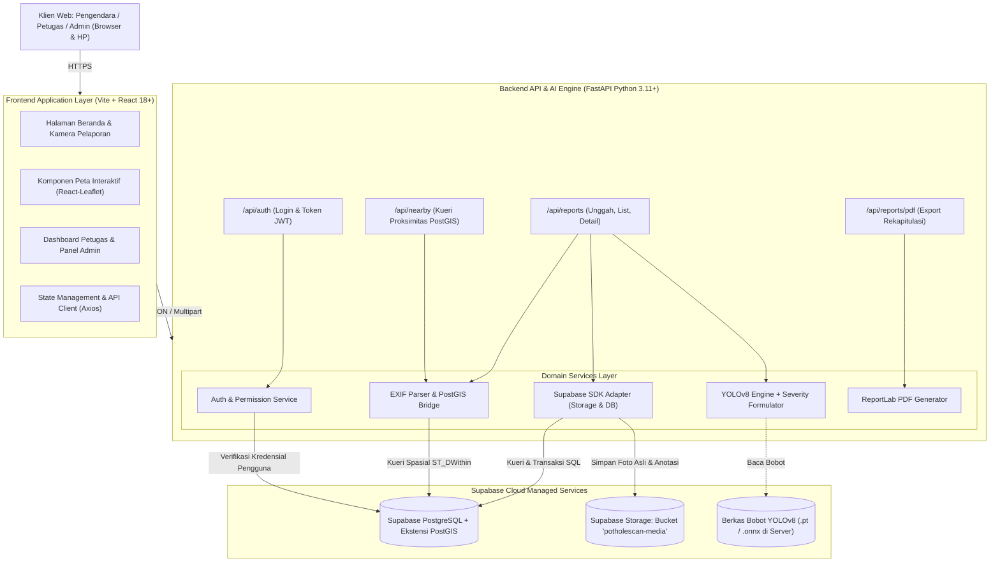
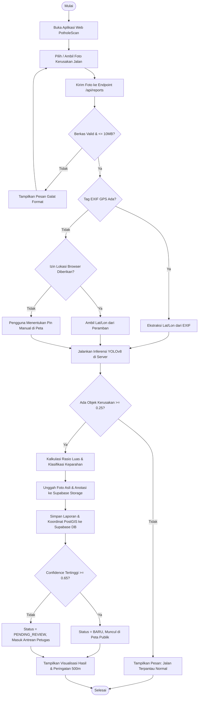
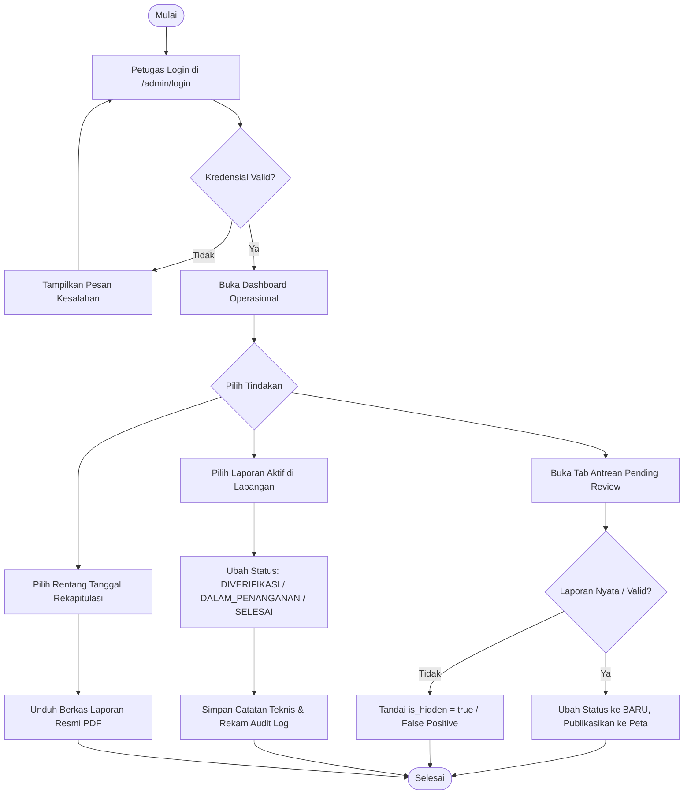
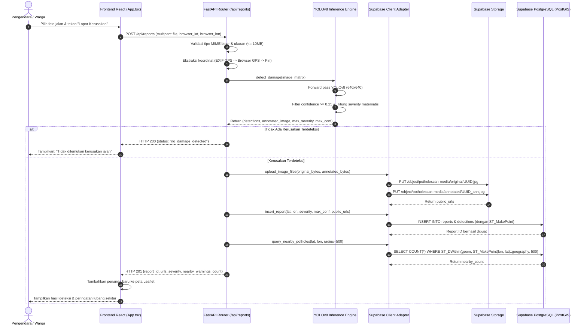
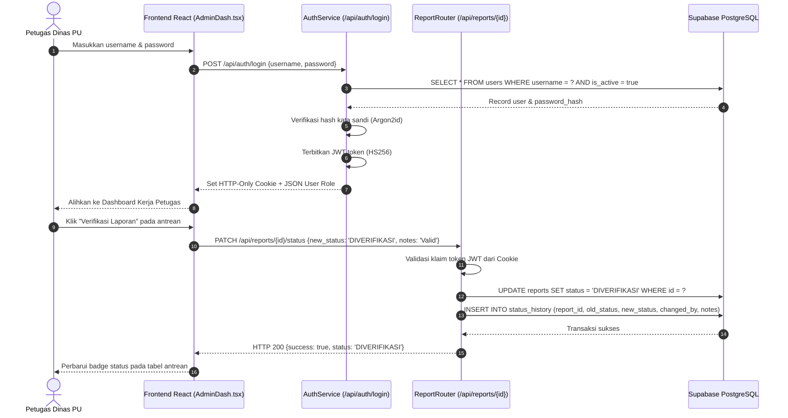
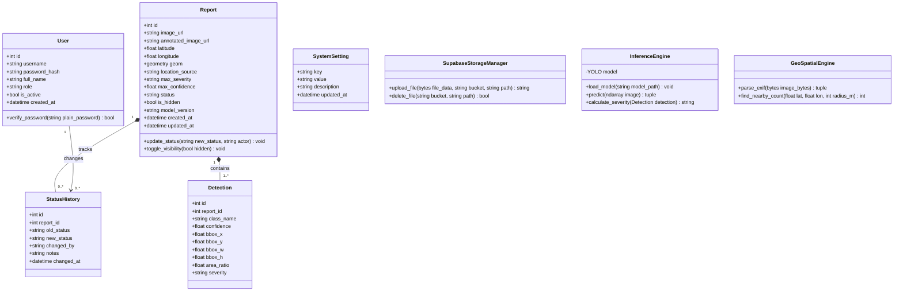
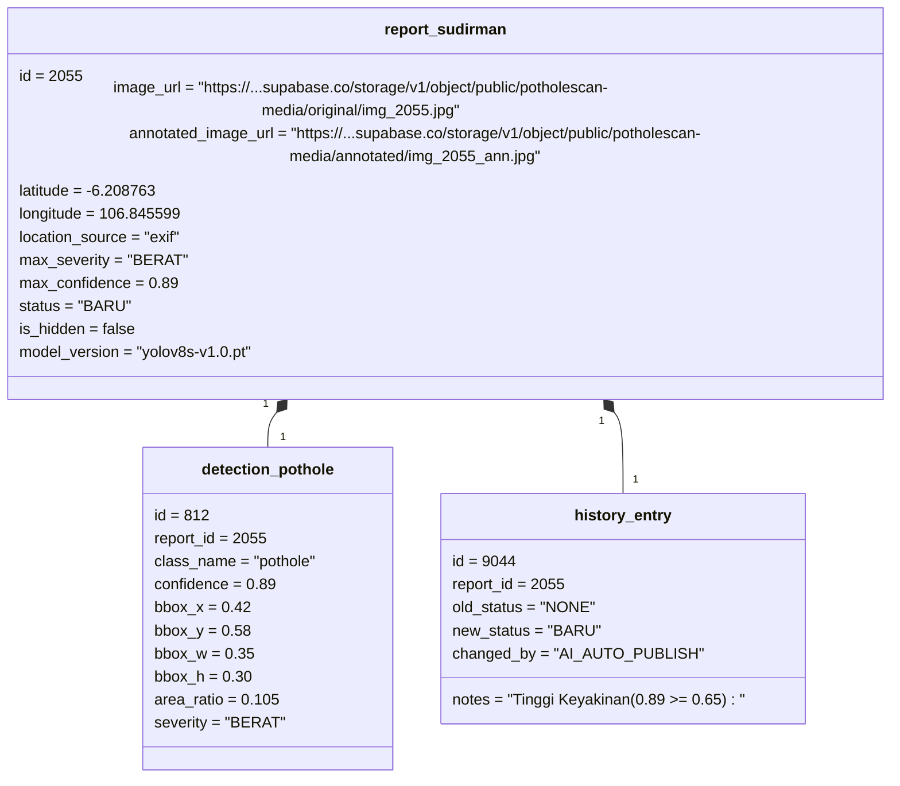

# HIGH-LEVEL DESIGN DOCUMENT (HDD) / SOFTWARE DESIGN DOCUMENTATION (SDD)
# SISTEM DETEKSI KERUSAKAN JALAN (POTHOLESCAN)

**Document Version:** 1.0 (Definitive Edition)  
**Status:** Approved for Development  
**Product:** PotholeScan MVP Platform  
**Target Architecture:** FastAPI + YOLOv8 + Supabase Cloud (PostgreSQL + PostGIS & Storage) + React/Leaflet  

---

## DAFTAR ISI

1. [Prinsip Desain & Arsitektur Sistem Terintegrasi](#1-prinsip-desain--arsitektur-sistem-terintegrasi)
2. [Dekomposisi Komponen & Alur Data](#2-dekomposisi-komponen--alur-data)
3. [Pemodelan UML Sistem (Mermaid Diagrams)](#3-pemodelan-uml-sistem-mermaid-diagrams)
   - 3.1 Use Case Diagram
   - 3.2 Activity Diagram (Pelaporan Warga & Verifikasi Petugas)
   - 3.3 Sequence Diagram (Deteksi AI + Supabase Cloud, Review Petugas, Unduh PDF)
   - 3.4 Class Diagram
   - 3.5 Object Diagram
4. [Desain Basis Data Relasional Supabase PostgreSQL + PostGIS](#4-desain-basis-data-relasional-supabase-postgresql--postgis)
5. [Desain Antarmuka Pemrograman Aplikasi (REST API Specification)](#5-desain-antarmuka-pemrograman-aplikasi-rest-api-specification)
6. [Desain Antarmuka Pengguna (UI Wireframe Blueprint)](#6-desain-antarmuka-pengguna-ui-wireframe-blueprint)
7. [Desain Keamanan, Error Handling & Supabase RLS](#7-desain-keamanan-error-handling--supabase-rls)
8. [Strategi Deployment & Analisis Trade-off Arsitektur](#8-strategi-deployment--analisis-trade-off-arsitektur)

---

## 1. Prinsip Desain & Arsitektur Sistem Terintegrasi

### 1.1 Prinsip Desain Utama
1. **Separation of Concerns (SoC):** Memisahkan dengan tegas antara layer antarmuka pengguna (React), layer API & inferensi numerik (FastAPI + YOLOv8), serta layer persistensi cloud terkelola (**Supabase PostgreSQL & Storage**).
2. **Stateless Backend:** Server backend FastAPI tidak menyimpan sesi di memori lokal; autentikasi dikelola dengan token JWT kriptografis yang diverifikasi pada setiap request.
3. **Optimized Cloud Storage:** Berkas biner foto berukuran besar disimpan langsung pada **Supabase Storage**, sedangkan basis data PostgreSQL hanya mengelola metadata tekstual, koordinat spasial, dan URL CDN.

### 1.2 Diagram Arsitektur Sistem Cloud Terintegrasi



---

## 2. Dekomposisi Komponen & Alur Data

### 2.1 Alur Data Pelaporan Utama (Warga $\to$ AI $\to$ Supabase)
1. **Pengunggahan:** Warga memilih atau memotret kerusakan jalan via antarmuka React. Berkas dikirimkan ke `POST /api/reports` bersama koordinat peramban (jika ada).
2. **Validasi & Ekstraksi Lokasi:** FastAPI memvalidasi integritas berkas (*magic bytes*). `GeoService` mengekstrak koordinat GPS dari tag EXIF; jika tidak ada, menggunakan geolokasi peramban atau pin manual.
3. **Eksekusi AI YOLOv8:** Citra di-*resize* ke $640 \times 640$ dan diinferensi. Model mendeteksi kelas `pothole` dan `crack`, memfilter deteksi dengan keyakinan $\ge 0.25$, serta menghasilkan citra beranotasi kotak pembatas.
4. **Kalkulasi Keparahan:** Sistem menghitung rasio luas ($R_{\text{area}}$) untuk lubang dan rasio bentang ($R_{\text{span}}$) untuk retak, lalu menentukan keparahan laporan (*worst-case escalation*).
5. **Unggah ke Supabase Storage:** Server mengunggah berkas foto asli dan foto beranotasi ke bucket `potholescan-media/original/` dan `potholescan-media/annotated/`.
6. **Persistensi ke Supabase PostgreSQL:** Metadata laporan, koordinat titik PostGIS (`ST_SetSRID(ST_MakePoint(lon, lat), 4326)`), keparahan, serta daftar kotak deteksi dicatat ke tabel `reports` dan `detections`.
7. **Penyaringan Visibilitas:** Jika keyakinan $\ge 0.65$, laporan berstatus `BARU` (langsung tampil di peta). Jika $0.25 - 0.64$, laporan berstatus `PENDING_REVIEW` (antrean kurasi petugas).
8. **Umpan Balik:** Respons HTTP 201 mengembalikan URL citra Supabase, daftar deteksi, derajat keparahan, serta jumlah lubang aktif sekitar radius $500\text{ meter}$.

---

## 3. Pemodelan UML Sistem (Mermaid Diagrams)

### 3.1 Use Case Diagram

```mermaid
flowchart LR
    Warga((Pengendara / Warga))
    Petugas((Petugas Lapangan PU))
    Admin((Administrator))

    subgraph PotholeScan ["Sistem PotholeScan (Supabase Cloud Integrated)"]
        UC01["Unggah Foto Jalan & Deteksi AI"]
        UC02["Tentukan Lokasi (EXIF / GPS / Pin)"]
        UC03["Jelajahi Peta Sebaran Lubang Publik"]
        UC04["Terima Peringatan Radius 500m"]
        UC05["Login Kredensial Petugas / Admin"]
        UC06["Verifikasi Laporan Pending Review"]
        UC07["Perbarui Status Siklus Penanganan"]
        UC08["Sembunyikan Laporan Keliru (False Positive)"]
        UC09["Unduh Berkas Laporan Rekapitulasi PDF"]
        UC10["Kelola Akun Staf Petugas"]
        UC11["Atur Ambang Keyakinan Publikasi"]
        UC12["Pantau Rekaman Audit Log"]
    end

    Warga --> UC01
    Warga --> UC02
    Warga --> UC03
    Warga --> UC04

    Petugas --> UC05
    Petugas --> UC06
    Petugas --> UC07
    Petugas --> UC08
    Petugas --> UC09

    Admin --> UC05
    Admin --> UC06
    Admin --> UC07
    Admin --> UC08
    Admin --> UC09
    Admin --> UC10
    Admin --> UC11
    Admin --> UC12

    UC01 ..>|<<include>>| UC02
```

---

### 3.2 Activity Diagram

#### A. Alur Aktivitas Pelaporan Warga ke Supabase Cloud



---

#### B. Alur Aktivitas Kurasi & Penanganan Petugas



---

### 3.3 Sequence Diagram

#### A. Sequence Diagram: Unggah Foto, Deteksi AI, dan Persistensi Supabase



---

#### B. Sequence Diagram: Login Petugas & Verifikasi Laporan di Supabase



---

### 3.4 Class Diagram



---

### 3.5 Object Diagram



---

## 4. Desain Basis Data Relasional Supabase PostgreSQL + PostGIS

> [!NOTE] Klarifikasi Arsitektur Skema Database Spasial
> Basis data PotholeScan pada Supabase PostgreSQL membedakan secara tegas antara **Tabel Operasional Aplikasi** (6 tabel) dan **Tabel Internal Ekstensi PostGIS** (1 tabel):
> 1. **Tabel Operasional Aplikasi (6 Tabel):**
>    - `public.users`: Autentikasi RBAC (Admin & Petugas) dengan hashing Argon2id.
>    - `public.reports`: Master data laporan jalan rusak, koordinat geospasial WGS84, keparahan agregat, dan status verifikasi.
>    - `public.detections`: Bounding box individual hasil deteksi YOLOv8 (`pothole`, `crack`), confidence score, dan rasio luasan.
>    - `public.status_history`: Jejak audit siklus hidup transisi status laporan (`BARU` &rarr; `DIVERIFIKASI` &rarr; `DIKERJAKAN` &rarr; `SELESAI`).
>    - `public.system_settings`: Persistensi parameter ambang deteksi dinamis AI (`confidence_threshold_min`, `confidence_threshold_publish`, `proximity_radius_meters`).
>    - `public.audit_logs`: Log kepatuhan aktivitas administratif dan mutasi data oleh pengguna berwenang.
> 2. **Tabel Sistem Bawaan PostGIS Internal (1 Tabel):**
>    - `public.spatial_ref_sys`: Tabel bawaan yang otomatis diinisialisasi saat perintah `CREATE EXTENSION postgis;` dieksekusi. Tabel ini berisi daftar referensi sistem koordinat proyeksi standar EPSG (misal EPSG:4326/WGS84). Tabel ini murni berfungsi untuk komputasi internal engine PostGIS (seperti fungsi `ST_DWithin` dan `ST_DistanceSphere`) dan **bukan merupakan tabel data operasional transaksi aplikasi**.

Berikut adalah DDL SQL lengkap yang siap dieksekusi pada *SQL Editor* Supabase:

```sql
-- 1. Mengaktifkan ekstensi geospasial PostGIS
CREATE EXTENSION IF NOT EXISTS postgis;

-- 2. Tabel Akun Pengguna (Petugas Lapangan & Administrator)
CREATE TABLE IF NOT EXISTS public.users (
    id BIGSERIAL PRIMARY KEY,
    username VARCHAR(50) NOT NULL UNIQUE,
    password_hash VARCHAR(255) NOT NULL,
    full_name VARCHAR(100) NOT NULL,
    role VARCHAR(20) NOT NULL CHECK (role IN ('petugas', 'admin')),
    is_active BOOLEAN NOT NULL DEFAULT true,
    created_at TIMESTAMPTZ NOT NULL DEFAULT timezone('utc'::text, now())
);

-- 3. Tabel Master Laporan Kerusakan Jalan
CREATE TABLE IF NOT EXISTS public.reports (
    id BIGSERIAL PRIMARY KEY,
    image_url TEXT NOT NULL,
    annotated_image_url TEXT NOT NULL,
    latitude DOUBLE PRECISION NOT NULL,
    longitude DOUBLE PRECISION NOT NULL,
    geom GEOMETRY(Point, 4326),
    location_source VARCHAR(20) NOT NULL CHECK (location_source IN ('exif', 'browser', 'manual')),
    max_severity VARCHAR(20) NOT NULL CHECK (max_severity IN ('RINGAN', 'SEDANG', 'BERAT')),
    max_confidence REAL NOT NULL,
    status VARCHAR(30) NOT NULL DEFAULT 'BARU' CHECK (status IN ('PENDING_REVIEW', 'BARU', 'DIVERIFIKASI', 'DALAM_PENANGANAN', 'SELESAI')),
    is_hidden BOOLEAN NOT NULL DEFAULT false,
    model_version VARCHAR(50) NOT NULL,
    created_at TIMESTAMPTZ NOT NULL DEFAULT timezone('utc'::text, now()),
    updated_at TIMESTAMPTZ NOT NULL DEFAULT timezone('utc'::text, now())
);

-- Trigger otomatis mengisi kolom PostGIS geom dari latitude dan longitude
CREATE OR REPLACE FUNCTION public.set_report_geom()
RETURNS TRIGGER AS $$
BEGIN
    NEW.geom := ST_SetSRID(ST_MakePoint(NEW.longitude, NEW.latitude), 4326);
    RETURN NEW;
END;
$$ LANGUAGE plpgsql;

CREATE OR REPLACE TRIGGER trg_set_report_geom
BEFORE INSERT OR UPDATE OF latitude, longitude ON public.reports
FOR EACH ROW EXECUTE FUNCTION public.set_report_geom();

-- Indeks Spasial GiST untuk kueri radius proksimitas super cepat
CREATE INDEX IF NOT EXISTS idx_reports_geom ON public.reports USING GIST (geom);
CREATE INDEX IF NOT EXISTS idx_reports_status ON public.reports (status);
CREATE INDEX IF NOT EXISTS idx_reports_created_at ON public.reports (created_at DESC);

-- 4. Tabel Rincian Kotak Deteksi Kerusakan
CREATE TABLE IF NOT EXISTS public.detections (
    id BIGSERIAL PRIMARY KEY,
    report_id BIGINT NOT NULL REFERENCES public.reports(id) ON DELETE CASCADE,
    class_name VARCHAR(20) NOT NULL CHECK (class_name IN ('pothole', 'crack')),
    confidence REAL NOT NULL,
    bbox_x REAL NOT NULL,
    bbox_y REAL NOT NULL,
    bbox_w REAL NOT NULL,
    bbox_h REAL NOT NULL,
    area_ratio REAL NOT NULL,
    severity VARCHAR(20) NOT NULL,
    created_at TIMESTAMPTZ NOT NULL DEFAULT timezone('utc'::text, now())
);

CREATE INDEX IF NOT EXISTS idx_detections_report_id ON public.detections (report_id);

-- 5. Tabel Riwayat Perubahan Status (Immutable Audit Trail)
CREATE TABLE IF NOT EXISTS public.status_history (
    id BIGSERIAL PRIMARY KEY,
    report_id BIGINT NOT NULL REFERENCES public.reports(id) ON DELETE CASCADE,
    old_status VARCHAR(30) NOT NULL,
    new_status VARCHAR(30) NOT NULL,
    changed_by VARCHAR(50) NOT NULL,
    notes TEXT,
    changed_at TIMESTAMPTZ NOT NULL DEFAULT timezone('utc'::text, now())
);

-- 6. Tabel Konfigurasi Sistem Dinamis
CREATE TABLE IF NOT EXISTS public.system_settings (
    key VARCHAR(100) PRIMARY KEY,
    value TEXT NOT NULL,
    description TEXT,
    updated_at TIMESTAMPTZ NOT NULL DEFAULT timezone('utc'::text, now())
);

-- 7. Tabel Log Audit Administrator
CREATE TABLE IF NOT EXISTS public.audit_logs (
    id BIGSERIAL PRIMARY KEY,
    actor_username VARCHAR(50) NOT NULL,
    action VARCHAR(50) NOT NULL,
    target_entity VARCHAR(50) NOT NULL,
    target_id BIGINT,
    details TEXT,
    created_at TIMESTAMPTZ NOT NULL DEFAULT timezone('utc'::text, now())
);

-- Inisialisasi Konfigurasi Baku
INSERT INTO public.system_settings (key, value, description) VALUES
('confidence_threshold_min', '0.25', 'Ambang batas minimal agar deteksi diterima'),
('confidence_threshold_publish', '0.65', 'Ambang batas keyakinan langsung tampil di peta publik'),
('proximity_radius_meters', '500', 'Radius peringatan lubang aktif sekitar pengendara')
ON CONFLICT (key) DO NOTHING;
```

---

## 5. Desain Antarmuka Pemrograman Aplikasi (REST API Specification)

### 5.1 `POST /api/reports`
- **Akses:** Publik (Rate Limiting: 5 req/menit per IP).
- **Request:** `multipart/form-data`
  - `file`: Berkas foto biner (JPEG/PNG $\le 10\text{ MB}$).
  - `latitude`: Float (opsional).
  - `longitude`: Float (opsional).
- **Response (HTTP 201 Created):**
```json
{
  "success": true,
  "report_id": 2055,
  "status": "BARU",
  "is_published_immediately": true,
  "location": {
    "latitude": -6.208763,
    "longitude": 106.845599,
    "source": "exif"
  },
  "severity": "BERAT",
  "image_url": "https://xyz.supabase.co/storage/v1/object/public/potholescan-media/original/img_2055.jpg",
  "annotated_image_url": "https://xyz.supabase.co/storage/v1/object/public/potholescan-media/annotated/img_2055_ann.jpg",
  "detections": [
    {
      "class_name": "pothole",
      "confidence": 0.89,
      "severity": "BERAT",
      "bbox": [0.42, 0.58, 0.35, 0.30]
    }
  ],
  "nearby_unresolved_count": 3
}
```

### 5.2 `GET /api/reports`
- **Akses:** Publik.
- **Query Params:** `severity` (opsional), `limit` (default 100).
- **Response (HTTP 200 OK):**
```json
{
  "total": 65,
  "items": [
    {
      "id": 2055,
      "latitude": -6.208763,
      "longitude": 106.845599,
      "severity": "BERAT",
      "status": "BARU",
      "thumbnail_url": "https://xyz.supabase.co/storage/v1/object/public/potholescan-media/annotated/img_2055_ann.jpg",
      "created_at": "2026-11-16T19:30:00Z"
    }
  ]
}
```

### 5.3 `GET /api/nearby`
- **Akses:** Publik.
- **Query Params:** `lat` (float), `lon` (float), `radius_m` (default 500).
- **Implementasi:** Mengeksekusi fungsi PostGIS `ST_DWithin`.
- **Response (HTTP 200 OK):**
```json
{
  "center": {"lat": -6.208763, "lon": 106.845599},
  "radius_meters": 500,
  "unresolved_damages_count": 3,
  "highest_severity": "BERAT"
}
```

### 5.4 `POST /api/auth/login`
- **Akses:** Publik.
- **Request Body (JSON):** `{"username": "petugas01", "password": "password_aman"}`
- **Response:** Mengatur *HTTP-Only Cookie* `access_token` dan mengembalikan data peran (`role`).

### 5.5 `PATCH /api/reports/{id}/status`
- **Akses:** Privat (Petugas / Admin).
- **Request Body (JSON):** `{"new_status": "DALAM_PENANGANAN", "notes": "Armada tambal meluncur"}`

### 5.6 `GET /api/reports/pdf`
- **Akses:** Privat (Petugas / Admin).
- **Query Params:** `from_date`, `to_date`, `status` (opsional).
- **Response:** Biner `application/pdf` berkas rekapitulasi dinas.

---

## 6. Desain Antarmuka Pengguna (UI Wireframe Blueprint)

### 6.1 Antarmuka Pelaporan Cepat Publik
```text
+-------------------------------------------------------------+
|  [Logo] POTHOLESCAN - Pantau Jalan PUPR           [Login]   |
+-------------------------------------------------------------+
|  +-------------------------------------------------------+  |
|  |           PETA SEBARAN JALAN RUSAK (LEAFLET)          |  |
|  |                                                       |  |
|  |        (o) Merah: Berat      (o) Kuning: Sedang       |  |
|  |                   (o) Hijau: Ringan                   |  |
|  +-------------------------------------------------------+  |
|  | [!] Waspada: Ada 3 lubang aktif dalam radius 500m     |  |
|  +-------------------------------------------------------+  |
|                                                             |
|  +-------------------------------------------------------+  |
|  |                LAPORKAN LUBANG JALAN                  |  |
|  |                                                       |  |
|  |   [  Kamera Langsung  ]     [  Pilih Dari Galeri  ]   |  |
|  |                                                       |  |
|  |   Status Lokasi: [OK] Terdeteksi dari GPS Foto        |  |
|  |   Koordinat: -6.20876, 106.84559                      |  |
|  |                                                       |  |
|  |               [  ANALISIS DENGAN AI  ]                |  |
|  +-------------------------------------------------------+  |
+-------------------------------------------------------------+
```

### 6.2 Antarmuka Dashboard Kerja Petugas Dinas
```text
+-------------------------------------------------------------+
|  POTHOLESCAN PETUGAS | Staf: Budi Santoso         [Logout]  |
+-------------------------------------------------------------+
|  [Antrean Pending (3)] | [Pekerjaan Aktif (12)] | [Unduh PDF] |
+-------------------------------------------------------------+
|  ID    | Foto & Lokasi   | Keparahan | Status       | Aksi  |
|--------+-----------------+-----------+--------------+-------|
| #2055  | [Foto] Jl. Sud  | BERAT     | BARU         | [Ubah]|
| #2054  | [Foto] Jl. Gat  | SEDANG    | DIVERIFIKASI | [Ubah]|
| #2051  | [Foto] Jl. Ras  | RINGAN    | SELESAI      | [Info]|
+-------------------------------------------------------------+
|  Modal Update Status:                                       |
|  Status Baru: [ DALAM_PENANGANAN v ]                        |
|  Catatan    : [ Material aspal cold-mix siap di lokasi    ] |
|  [ ] Sembunyikan Laporan (Tandai False Positive)            |
|  [ Batal ]                                 [ Simpan Progres ]|
+-------------------------------------------------------------+
```

---

## 7. Desain Keamanan, Error Handling & Supabase RLS

### 7.1 Kebijakan Supabase Row Level Security (RLS)
Untuk melindungi basis data dari akses tidak sah:
```sql
-- Aktifkan RLS pada tabel reports
ALTER TABLE public.reports ENABLE ROW LEVEL SECURITY;

-- 1. Siapa pun dapat membaca laporan publik yang tidak tersembunyi
CREATE POLICY "Public Read Active Reports"
ON public.reports FOR SELECT
TO anon, authenticated
USING (is_hidden = false AND status IN ('BARU', 'DIVERIFIKASI', 'DALAM_PENANGANAN', 'SELESAI'));

-- 2. Hanya backend FastAPI (Service Role) yang dapat menulis dan melihat antrean pending
CREATE POLICY "Service Role Full Access"
ON public.reports FOR ALL
TO service_role
USING (true)
WITH CHECK (true);
```

### 7.2 Penanganan Galat Sistem (Error Handling)
- **File Corrupt / Invalid MIME:** Mengembalikan HTTP 422 dengan pesan: *"Berkas bukan citra JPEG/PNG yang valid"*.
- **Rate Limit Exceeded:** Mengembalikan HTTP 429 dengan header `Retry-After: 60`.
- **Kegagalan Jaringan Supabase:** Sistem menangkap *timeout exception* dan mengembalikan status HTTP 503 dengan log kesalahan tercatat rapi.

---

## 8. Strategi Deployment & Analisis Trade-off Arsitektur

### 8.1 Deployment Stack (Paved Path)
- **Frontend SPA:** Di-deploy ke Vercel / Netlify / Nginx Statis.
- **Backend API:** Di-deploy pada VPS berbasis Linux (Ubuntu 22.04 LTS / 24.04 LTS) yang menjalankan Python 3.11, FastAPI, Uvicorn, dan model YOLOv8.
- **Database & Storage:** Dikelola sepenuhnya oleh **Supabase Cloud Managed Services**.

### 8.2 Analisis Keputusan Desain & Trade-offs (Arsitektur Kompromi)

| Keputusan Desain | Keuntungan Utama | Kompromi / Trade-off | Strategi Mitigasi |
| :--- | :--- | :--- | :--- |
| **Supabase PostgreSQL + PostGIS (menggantikan SQLite)** | Kueri geospasial native (`ST_DWithin`), indeks GiST super cepat, konkurensi multi-pengguna tanpa batas. | Membutuhkan koneksi internet dan manajemen kredensial API cloud. | Kunci *Service Role* disimpan aman di server backend, query dioptimalkan dengan indeks. |
| **Supabase Storage (menggantikan Disk Lokal Server)** | Server backend tetap ringan tanpa risiko kehabisan kapasitas harddisk (*disk exhaustion*); aset dilayani CDN global. | Ada kuota bandwidth dan limit ukuran berkas pada tier gratis. | Citra dikompresi sebelum diunggah; batas ukuran citra dibatasi $\le 10\text{ MB}$. |
| **Model YOLOv8 di Server FastAPI (bukan Edge/Mobile)** | Warga tidak dibebani unduhan file bobot AI di HP; inferensi konsisten di semua perangkat. | Server menanggung beban komputasi CPU/GPU saat ada unggahan massal. | Diterapkan *rate limiting* 5 req/menit dan model dioptimalkan ke varian Nano/Small. |
| **Visibilitas Bertingkat (Confidence Tiering)** | Peta publik bersih dari deteksi keliru (*false positive*); laporan jelas langsung terbit tanpa tertahan antrean. | Petugas harus secara berkala memeriksa antrean *Pending Review*. | Disediakan tab antrean khusus dan notifikasi visual pada dashboard petugas. |
