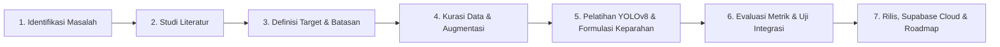
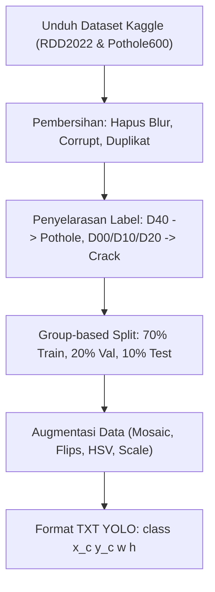

# METODOLOGI PENELITIAN & PENGEMBANGAN (R&D)
# SISTEM DETEKSI KERUSAKAN JALAN (POTHOLESCAN)

**Nomor Dokumen:** PS-MET-2026-V1.0  
**Versi:** 1.0 (Definitive Edition)  
**Status:** Approved for Implementation  
**Topik:** Rekayasa Sistem Deteksi Lubang & Retak Jalan Berbasis Deep Learning (YOLOv8) & Supabase Cloud GIS  

---

## DAFTAR ISI

1. [Ringkasan Alur Metodologi](#1-ringkasan-alur-metodologi)
2. [Langkah 1: Identifikasi Masalah & Formulasi Riset](#2-langkah-1-identifikasi-masalah--formulasi-riset)
3. [Langkah 2: Studi Literatur & Komparasi Algoritma](#3-langkah-2-studi-literatur--komparasi-algoritma)
4. [Langkah 3: Definisi Tujuan, Spesifikasi Target, dan Batasan Sistem](#4-langkah-3-definisi-tujuan-spesifikasi-target-dan-batasan-sistem)
5. [Langkah 4: Pengumpulan Data, Kurasi, dan Pipeline Preprocessing](#5-langkah-4-pengumpulan-data-kurasi-dan-pipeline-preprocessing)
6. [Langkah 5: Desain Eksperimen, Pelatihan Model, dan Formulasi Keparahan](#6-langkah-5-desain-eksperimen-pelatihan-model-dan-formulasi-keparahan)
7. [Langkah 6: Evaluasi Model, Kalibrasi Ambang, dan Pengujian Sistem](#7-langkah-6-evaluasi-model-kalibrasi-ambang-dan-pengujian-sistem)
8. [Langkah 7: Komunikasi Hasil, Deployment Cloud Supabase, dan Roadmap](#8-langkah-7-komunikasi-hasil-deployment-cloud-supabase-dan-roadmap)

---

## 1. Ringkasan Alur Metodologi

Metodologi yang digunakan adalah **7 Langkah Research & Development (R&D) / Engineering Lifecycle Diperluas**. Kerangka kerja ini memadukan ketelitian riset ilmiah *Computer Vision* (pengolahan data, pelatihan model, kalibrasi matematis) dengan standar rekayasa perangkat lunak modern berbasis arsitektur *Cloud Backend-as-a-Service* (Supabase PostgreSQL + Storage).

---

## 2. Langkah 1: Identifikasi Masalah & Formulasi Riset

### 2.1 Masalah Empiris Lapangan
Pemeliharaan infrastruktur jalan oleh Dinas Pekerjaan Umum dan Penataan Ruang (PUPR) / Bina Marga di Indonesia menghadapi kendala struktural:
1. **Survei Lapangan Manual:** Petugas menyusuri jalan secara visual, memakan waktu berhari-hari, menimbulkan biaya operasional bahan bakar dan personel yang tinggi, serta berisiko kecelakaan kerja.
2. **Subjektivitas Klasifikasi:** Surveyor manusia memiliki persepsi berbeda terhadap ukuran lubang jalan (apakah tergolong rusak ringan, sedang, atau berat) tanpa parameter metrik yang konsisten.
3. **Ketiadaan Kanal Partisipasi Warga yang Presisi:** Warga yang menemui lubang sering mengeluh di media sosial tanpa menyertakan titik koordinat GPS yang akurat, menyulitkan petugas menemukan lokasi fisik.
4. **Data Tercecer & Tanpa Geospasial:** Data survei manual disimpan dalam formulir kertas atau spreadsheet terpisah, menghambat pimpinan dinas dalam memprioritaskan penambalan aspal pada klaster jalan paling berbahaya.

### 2.2 Rumusan Masalah Riset & Rekayasa
1. Bagaimana melatih model *deep learning* arsitektur YOLOv8 yang mampu mendeteksi kerusakan **Lubang** (*pothole*) dan **Retak** (*crack*) dari citra jalan dengan akurasi tinggi ($\text{mAP@0.5} \ge 0.70$) dan latensi inferensi cepat ($\le 1.0\text{ detik}$)?
2. Bagaimana memformulasikan kalkulasi tingkat keparahan (*severity index*) berbasis rasio dimensi geometris kotak pembatas (*bounding box*) secara deterministik?
3. Bagaimana merancang arsitektur sistem web yang menghubungkan mesin inferensi FastAPI dengan layanan basis data terkelola **Supabase PostgreSQL (PostGIS)** dan **Supabase Storage** untuk menyajikan peta publik serta dasbor penanganan dinas?

### 2.3 Batasan Ruang Lingkup (Scope Boundaries)
- **Modalitas Data:** Citra foto statis digital (format JPEG/PNG, resolusi $\ge 640 \times 640$ piksel, ukuran berkas $\le 10\text{ MB}$).
- **Kondisi Lingkungan:** Foto diambil pada siang hari dengan pencahayaan cukup. Kondisi malam gulita dan genangan air banjir total berada di luar batasan MVP.
- **Kelas Deteksi Target:** Dibatasi pada 2 kelas berbobot tinggi: `pothole` (lubang) dan `crack` (retak jalan).

---

## 3. Langkah 2: Studi Literatur & Komparasi Algoritma

### 3.1 Pendekatan Tradisional vs Deep Learning
Metode pengolahan citra klasik (*edge detection* Canny, *thresholding* Otsu) sangat mudah terkecoh oleh bayangan pohon, tambalan aspal basah, dan perubahan cuaca. *Deep Convolutional Neural Networks* (CNN) terbukti lebih tangguh karena mengekstraksi representasi fitur hierarkis (*low-level texture* hingga *high-level semantic shape*) secara otomatis.

### 3.2 Analisis Komparasi Arsitektur Deteksi Objek

| Paradigma | Model | Keunggulan | Kelemahan | Kesesuaian Sistem |
| :--- | :--- | :--- | :--- | :--- |
| **Two-Stage** | Faster R-CNN | Lokalisasi kotak pembatas sangat presisi | Komputasi berat, latensi lambat ($>2\text{ detik}$ CPU) | Kurang cocok untuk API web cepat |
| **One-Stage (Anchor-Based)** | SSD | Lebih cepat dibanding Faster R-CNN | Kesulitan mengenali retak aspal yang tipis | Kurang optimal |
| **One-Stage (Anchor-Free)** | **YOLOv8** | Keseimbangan terbaik antara mAP, recall, dan kecepatan inferensi; *anchor-free head*; modul C2f efisien | Memerlukan kalibrasi ambang keyakinan (*confidence threshold*) yang tepat | **Dipilih sebagai arsitektur inti (Paved Path)** |

### 3.3 State-of-the-Art Dataset
- **RDD2022 (Road Damage Detection 2022):** Dataset multi-negara skala besar dengan anotasi resmi kerusakan jalan.
- **Pothole600 & Kaggle Pothole Datasets:** Koleksi ribuan citra fokus lubang jalan nyata dari perspektif pengemudi.

---

## 4. Langkah 3: Definisi Tujuan, Spesifikasi Target, dan Batasan Sistem

### 4.1 Target Kuantitatif Machine Learning
- $\text{mAP@0.5} \ge 0.70$ (Mean Average Precision pada IoU threshold 0.50 pada data uji).
- $\text{Recall (Pothole)} \ge 0.75$ (Memastikan seminimal mungkin lubang berbahaya yang lolos).
- $\text{Recall (Crack)} \ge 0.70$.
- Waktu Inferensi Server: $\le 1.0\text{ detik/citra}$ pada lingkungan komputasi CPU 4-core standar.

### 4.2 Target Rekayasa Sistem
- Waktu siklus total: Dari pengunggahan foto hingga tampilan hasil deteksi, kalkulasi keparahan, dan penandaan lokasi di peta $\le 5.0\text{ detik}$.
- Penentuan lokasi bertingkat (*Tiered Geolocation*): Ekstraksi EXIF GPS $\to$ Fallback Browser Geolocation $\to$ Pin manual Leaflet.
- Integrasi Cloud Supabase: Penyimpanan biner foto pada **Supabase Storage** dan persistensi metadata laporan pada **Supabase PostgreSQL**.

---

## 5. Langkah 4: Pengumpulan Data, Kurasi, dan Pipeline Preprocessing

### 5.1 Sumber Data dari Kaggle
Data dikumpulkan dari repositori terbuka di Kaggle:
1. **RDD2022 Subset:** Mengambil subset data dari wilayah Asia/India/Jepang untuk mencerminkan karakteristik aspal jalan tropis.
2. **Kaggle Pothole Detection / Pothole600:** Dataset citra lubang jalan dengan sudut pandang pengendara.

### 5.2 Standarisasi Label Menjadi 2 Kelas
- **Kelas 0 - `pothole`:** Dipetakan dari kode RDD D40 dan seluruh label *pothole* pada dataset sekunder.
- **Kelas 1 - `crack`:** Menggabungkan kode RDD D00 (retak memanjang), D10 (retak melintang), dan D20 (retak buaya).

### 5.3 Pencegahan Kebocoran Data (Data Leakage Guard)
Pembagian data dilakukan **berdasarkan sekuens/ruas jalan perekaman** (*grouped split*), bukan pengacakan independen baris citra:
- **70% Training Set:** Optimasi gradien bobot model.
- **20% Validation Set:** Penentuan *early stopping* dan tuning hyperparameter.
- **10% Test Set:** Evaluasi performa final yang tidak tersentuh proses pelatihan.

### 5.4 Strategi Augmentasi Data
- Horizontal Flip ($p = 0.5$).
- Random Scaling ($\pm 20\%$) dan Random Translation ($\pm 10\%$).
- Penyesuaian HSV (Hue $\pm 0.015$, Saturation $\pm 0.4$, Value $\pm 0.3$) untuk simulasi perbedaan terik matahari.
- Mosaic Augmentation bawaan YOLOv8 (dimatikan pada 10 epoch terakhir).

---

## 6. Langkah 5: Desain Eksperimen, Pelatihan Model, dan Formulasi Keparahan

### 6.1 Desain Matriks Eksperimen Model
Melatih 3 varian YOLOv8 dengan bobot awal (*pre-trained weights*) COCO:
1. **YOLOv8n (Nano):** $\approx 3.2\text{M}$ parameter. Varian teringan untuk inferensi CPU.
2. **YOLOv8s (Small):** $\approx 11.2\text{M}$ parameter. Keseimbangan performa dan akurasi.
3. **YOLOv8m (Medium):** $\approx 25.9\text{M}$ parameter. Varian acuan untuk batas akurasi atas.

### 6.2 Konfigurasi Pelatihan
- Input Resolution: $640 \times 640$ piksel.
- Optimizer: SGD (momentum 0.937, weight decay 0.0005) atau AdamW.
- Learning Rate: $\eta_0 = 0.01$ dengan Cosine Annealing Decay.
- Batch Size: 16, Maksimal 100 epoch dengan *Early Stopping* (patience = 15).
- Random Seed: Ditetapkan statis (`seed=42`) untuk keterulangan ilmiah.

### 6.3 Formulasi Keparahan 2-Jalur Terkalibrasi (2-Track Calibrated Severity)

#### A. Keparahan Lubang (Pothole)
Dihitung berdasarkan rasio luas kotak terhadap luas total citra ($R_{\text{area}}$):
$$R_{\text{area}} = \frac{w_{\text{box}} \times h_{\text{box}}}{W_{\text{img}} \times H_{\text{img}}}$$

Aturan klasifikasi keparahan lubang:
$$\text{Severity}_{\text{pothole}} = \begin{cases} 
\text{RINGAN}, & \text{jika } R_{\text{area}} < 0.02 \ ( < 2\% ) \\
\text{SEDANG}, & \text{jika } 0.02 \le R_{\text{area}} < 0.08 \ ( 2\% - 7.99\% ) \\
\text{BERAT}, & \text{jika } R_{\text{area}} \ge 0.08 \ ( \ge 8\% )
\end{cases}$$

#### B. Keparahan Retak (Crack)
Dihitung berdasarkan rasio dimensi terpanjang kotak terhadap dimensi maksimum citra ($R_{\text{span}}$):
$$R_{\text{span}} = \frac{\max(w_{\text{box}}, h_{\text{box}})}{\max(W_{\text{img}}, H_{\text{img}})}$$

Aturan klasifikasi keparahan retak:
$$\text{Severity}_{\text{crack}} = \begin{cases} 
\text{RINGAN (Minor Crack)}, & \text{jika } R_{\text{span}} < 0.05 \ ( < 5\% ) \\
\text{BERAT (Major Crack)}, & \text{jika } R_{\text{span}} \ge 0.05 \ ( \ge 5\% )
\end{cases}$$

#### C. Keparahan Laporan Keseluruhan (Report Severity)
Jika sebuah citra memuat $N$ objek terdeteksi, keparahan laporan adalah nilai tertinggi di antara seluruh deteksi (*worst-case escalation*):
$$\text{Severity}_{\text{report}} = \max_{i=1}^N \left( \text{Severity}(d_i) \right)$$
dengan hierarki bobot: $\text{BERAT} > \text{SEDANG} > \text{RINGAN}$.

---

## 7. Langkah 6: Evaluasi Model, Kalibrasi Ambang, dan Pengujian Sistem

### 7.1 Evaluasi Kuantitatif
Model diuji pada data uji yang tidak tersentuh (*blind test set*):
- **Precision:** $P = \frac{TP}{TP + FP}$
- **Recall:** $R = \frac{TP}{TP + FN}$
- **F1-Score:** $F_1 = 2 \times \frac{P \times R}{P + R}$
- **mAP@0.5:** Luas area kurva P-R pada IoU 0.50.

### 7.2 Kalibrasi Ambang Keyakinan Bertingkat (Confidence Tiering)
1. $\text{Confidence} \ge 0.65$: **Tinggi**. Laporan langsung terbit berstatus `BARU` di peta publik.
2. $0.25 \le \text{Confidence} < 0.65$: **Sedang**. Laporan masuk antrean petugas berstatus `PENDING_REVIEW` guna mencegah *false positive* membingungkan warga.
3. $\text{Confidence} < 0.25$: **Rendah**. Diabaikan oleh sistem (tidak disimpan ke database).

### 7.3 Pengujian Sistem Komprehensif
- **Uji Unit:** Validasi parser EXIF, formula keparahan, dan formula Haversine / PostGIS ST_DistanceSphere.
- **Uji Integrasi API:** Validasi upload FastAPI, penolakan file non-gambar, dan proteksi JWT.
- **Uji Supabase Cloud:** Pengujian pengunggahan berkas biner ke Supabase Storage dan penulisan transaksi data ke Supabase PostgreSQL.

---

## 8. Langkah 7: Komunikasi Hasil, Deployment Cloud Supabase, dan Roadmap

### 8.1 Keluaran Utama (Artefak)
1. Bobot model terlatih `best.pt` dan format terkompresi `best.onnx`.
2. Repositori kode terstruktur: Backend FastAPI, Frontend React/Leaflet, dan skema migrasi Supabase PostgreSQL.
3. Dokumentasi lengkap: Metodologi, Tech Stack, PRD, SRS IEEE 830, dan HDD/SDD.

### 8.2 Topologi Cloud Supabase
* Backend FastAPI bertindak sebagai orkestrator inferensi AI.
* Setelah inferensi, FastAPI mengunggah citra asli dan citra beranotasi langsung ke bucket `potholescan-media` di **Supabase Storage**.
* Metadata laporan, titik koordinat, dan histori status disimpan di **Supabase PostgreSQL**.

### 8.3 Keterbatasan & Roadmap Pasca-MVP
- Keterbatasan: Pengaburan otomatis (*automatic blurring*) plat nomor dan wajah belum diterapkan pada versi MVP.
- Roadmap: Implementasi segmentasi semantik poligon (YOLOv8-seg) untuk kalkulasi volume aspal ($m^3$) dan integrasi aplikasi Android/iOS dengan *on-device inference*.
